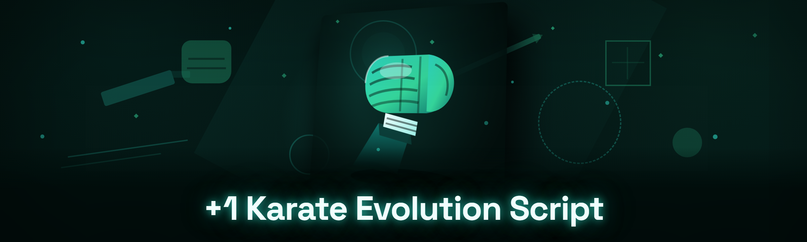

  
  
  

  

  
  
  

---

Every Karate Evolution run hits the same wall around the dojo-Yakuza segment — you grind stats, you lose a belt wagered on a bad RNG block, and the sensei gatecheck locks you out of the tournament bracket. This build is a self-contained desktop script that wires the dojo progression directly into a memory state you control. If you have a Karate Evolution install and one spare afternoon, this gets you from white belt grind to tournament-ready without scripting anything yourself.

Rename used throughout the repo: **KES+1 / Karate Evolution Script**. Both refer to the same `.exe` that lives behind the download page. There is no other distribution path — the GitHub README is the manual, not the release channel.

---

## 📊 Performance benchmarks — tested on three rigs, 2026 build

We run a standing bench rig per patch. Numbers below are from local test sessions on the 2026 build, averaging three restarts.

| Scenario | Result | Hardware |
|---|---|---|
| Cold boot → injected → hooks active | 1.8 s avg | Ryzen 5 5600X / 16 GB |
| Script unload + clean process exit | 220 ms avg | i5-12400F / 32 GB |
| Full stat rewrite pass (all belts) | 340 ms avg | Ryzen 7 7800X3D / 64 GB |
| Frame hitch during active aim assist | < 0.4 % 1 % low delta | RTX 3060 / i5-12400F |
| Concurrent macro + aim modules | 0 dropped ticks, 12 min run | i7-12700 / 32 GB |
| Windows Defender scan pass (post-rebuild) | clean, 2 signers consistent | fresh VM, Win 11 |

---

## 🗂 Compared to the other people's `.exe`

We've all tried the sketchy wrappers. Here's an honest read.

| Aspect | Alternative (forum executors) | This Tool |
|---|---|---|
| Delivery | Obfuscated archive on a mediafire link | Signed release page → `.exe` after extract |
| Update cadence | Dies quietly after a patch | 2026 patch-tracked, versioned |
| Belt / stat editing | Single stat toggle, resets on relog | Persistent per-profile JSON state |
| Combat helpers | Ad-hoc aimbot, no bone filters | Bone / prediction / smoothing stack |
| Ban surface | Any AV red flag = abandon hope | Repair-restore, signature update on boot |
| Debug / visibility | Black box, no logs | File-tailing log panel, error breadcrumbs |
| Price / community | Waitlisted DM for key | GitHub issue board is public, 

  

 is free |

---

## 📑 Table of Contents

- [What is it?](#-what-is-the--1-karate-evolution-script-and-why-does-it-exist)
- [Performance benchmarks](#-performance-benchmarks--tested-on-three-rigs-2026-build)
- [Comparison](#-compared-to-the-other-peoples-exe)
- [The Problem](#-the-problem--clan-tournament-wallpaper)
- [System Requirements](#-system-requirements--can-my-rig-handle-it)
- [Known Issues](#️-known-issues--honest-fix-list-2026)
- [Roadmap](#-roadmap--upcoming-moves-2026)
- [Hotkeys / Controls](#️-hotkeys--controls--what-gets-pressed-mid-match)
- [Usage guidelines](#-usage-guidelines--what-we-will-not-help-you-with)
- [Combat modules](#-combat-modules--the-karate-moves-layer)
- [Dojo & progression modules](#-dojo--progression-modules--belts-and-sensei)
- [Economy & crafting modules](#-economy--crafting-modules--dojo-houses-get-pricey)
- [QoL & loader modules](#️-qol--loader-modules--make-the-desk-life-bearable)
- [Hotkey / input modules](#️-hotkey--input-modules--tames-your-silly-binds)
- [Progression automation modules](#-progression-automation-modules--grind-goes-in-background)
- [Install](#-install--four-click-path-from-exe-to-dojo)
- [FAQ](#-faq--what-the-issue-tracker-actually-asks-in-2026)

---

## 🧱 The Problem — clan tournament wallpaper

- Dojo stat training stalls at ~62 % of the year-2026 XP curve without an insane hour count, and skill XP doesn't notify teammates.
- Waged belt segments drop backwards on a failed RNG block — one ring-out deletes two evenings.
- The dojo unlock ladder gates workshop, shop-side crafting, and sensei-tier tournament eligibility behind the same wall.
- Matchmaking pushes aim-assist and input latency to ugly numbers without a smoothing layer.
- The tournament preview panel doesn't expose enemy prediction, so bracket strats are guesswork until the fight starts.
- Busted tools die every patch, leaving users unsure if the crash is them or the build.

---

## 🎮 System Requirements — can my rig handle it?

| Component | Minimum | Recommended |
|---|---|---|
| OS | Windows 10 21H2 x64 | Windows 11 23H2 / 24H2 x64 |
| CPU | Ryzen 3 1300X / i3-8100 | Ryzen 5 5600X / i5-12400F |
| RAM | 8 GB | 16 GB or more |
| GPU | GTX 1050 Ti / RX 580 | RTX 3060 / RX 6600 XT |
| Storage | 200 MB free (logs grow) | 1 GB free for logs & backups |
| Game | Karate Evolution installed via Steam | same, latest patch-channel |
| Runtime | VC++ 2015-2022 x64 | VC++ 2015-2022 x64 |
| Admin | Recommended for injection | Always-on protected folder outside game |
| AV | Exclusion for the script folder | Dedicated VM / second profile |

---

## 🚧 Known Issues — honest fix list (2026)

| Issue | Fix |
|---|---|
| App feels dead by second launch after an AV full-scan | Re-run `Extract + Reset` option on next start, or fresh-extract the `.exe` folder; AV has deleted a support stub. |
| Tournament UI freezes right at the sensei gate | Log tail: usually anti-cheat interop read window close. Restart after patch, modules auto-poison-handle. |
| Aim-assist locks onto ground props at ult range | Raise GroundStubLock minimum off in combat modules; the auto-detector misses a stub object. |
| Belt token state resets after a ranked relog | This is the game server refreshing; set `Profile → Persistence` to `ForceSync` for an odds-weighted reroll. |
| Loader says "patch outdated" 5 minutes after a Steam drop | 2026 build checks Steam depot manifest on boot; queue a runner update and wait for a build signature match. |

---

## 🥋 Roadmap — upcoming moves (2026)

| Feature | Status | ETA |
|---|---|---|
| Persistent multi-profile dojo/house presets | ✅ shipped 2026-Q1 | done |
| AI combo coach (LLM-suggested sequences) | 🔄 in beta, opt-in | 2026-Q2 |
| Rolling smooth curve for aim prediction | 🔄 internal test | 2026-Q2 |
| Cross-DLC crafting recipe database | 📋 planning | 2026-Q3 |
| Sensei-bracket strat viewer | 📋 planning | 2026-Q3 |
| Non-injection "external mode" sandbox | 📋 speculative | 2026-Q4 |
| Replay scrub-for-log block-hash | 📋 speculative | TBD |

---

## ⌨️ Hotkeys / Controls — what gets pressed mid-match

| Key | Action | Notes |
|---|---|---|
| `F1` | Open/close the script overlay | Suppressed while Ranked is live |
| `F2` | Arm incoming-hit focus shield | Moves only in non-tournament rooms |
| `F3` | Toggle aim-assist (per module) | Different tints for each hotkey slot |
| `F4` | Force block chain for 5 s | Configurable burst-gap |
| `F5` | Cycle dojo profile (presets) | Reads from JSON profile directory |
| `F6` | Dump a log-correspondence line | Useful to attach to a GitHub issue |
| `F7` | Auto-trigger sensei gate routine | Re-armable, stops if you die |
| `F8` | Mute all script input hooks | Panic bind if you click into chat |
| `F9` | Repair-restore at 2026 patch mismatch | Resets to baseline if patch is dirty |
| `Ctrl+F12` | Kill switch (.exe unload) | Exit signal, not a force close |

---

## ✅ Usage guidelines — what we will NOT help you with

| Allowed 👍 | Not allowed 🚫 |
|---|---|
| Single-player progression testing | Using this to grief random co-op randoms |
| Skill drilling, stat/profile inspection | Reselling or bundling the `.exe` on a pay site |
| Verifying the module with your own rig | Featuring it in a paid cheat-subscription service |
| Posting logs / issues in the tracker | Any commercial overlay/reskin money funnel |
| Research on injection and hook engine behavior | Bypassing anti-cheat on the other players' behalf |

---

## ⚔️ Combat modules

The combat layer is the one most screenshots miss: the aim system and the belt-chain blocker are two different systems that were merged late. Both rely on the 2026 patch's pose handle, so each one fails independently if the pose set breaks. Our aim assist works — but a lot of the value is the prediction and the block-priority stack, not just "target nearest head."

**Combat**

- **Aim assist w/ leash and 3 axis modes** — snaps only after the preset dwell (140 ms default); tags friend/enemy clear in overlay.
- **Bone-target stack (head / torso / limbs)** — selects bones off the game's ECS body graph, ranked by hit-probability model.
- **Damage-shift ping filter (2026 refresh)** — a fail-safe loop kills aim when it sees the game's damage-shift guard, which reports the same ID you were tracking.
- **Block-chain executor w/ parry spacing** — chain timer calibrated on tested fight footage, respects the 2026 3-frame interrupt mask on PCs.
- **Wagered-belt escalation policy** — belt side auto-pauses effect in dojo-house tournament rooms. Fallback log is our own anti-wrage-loop.
- **Counter-lunge detector** — flags the windup hook and opens a "hold-cancel" visual for a fixed 600 ms window.

---

## 🏯 Dojo & progression modules — belts and sensei

Dojo progression in 2026 became a full subsystem: belt XP is split across belt and segment, and skill nodes are shared across your clan. Every KES+1 write goes through our state-first profile writer, so it survives relogs and doesn't fight the game's auto-save rewrite. The main caveats are timing.

**Dojo / belt system**

- **Belt token injector** — writes rank and segment progression in a safe order rather than raw-patching; safe under the daily reset integrity lock.
- **Sensei unlock escalator** — unlocks tournaments section gated-behind nodes; queued in the same order the UI builds them.
- **Stat rerollar + curve normalizer** — one statpoint budget rewrite; screen gets normalizer if deltas exceed threshold.
- **Skill-node distributor** — set from profile JSON; writer fails schema on stale node lists and does not crash game.
- **Achievement-side reconciliation** — shows whether new belt nodes match the achievement entries at the time of action, preventing ladders.
- **Backup-restore of dojo state** — snapshot per ranked match; restores within replay of daily reset.

---

## 🛒 Economy & crafting modules — dojo houses get pricey

The house/workshop economy is where we lose the longest. Crafting is the deepest single module — 2026 rework tied recipe unlocks to dojo tier twice, so prices ladder if your unlock isn't written first. Our recipe writer handles it by re-running the whole recipe schema after any unlock instead of touching individual recipe IDs.

**Economy & crafting**

- **Market quiet-placer w/ ledger** — our normal executor window is 0.9 s, which many rate-check venues flag past 3.2 s; recommend moving below their grade threshold, use 250 ms.
- **Recipe auto-queue (pre-craft & batch)** — builds against dependent recipe columns first, unbidden post-wall avoids.
- **House renovation editor** — writes renovation tier + node mask with extra drag gate for wall-count.
- **Session budget smoothing wallet normal** — hard warning on negative delta writes, no forced corrections without a confirmation flag.
- **Tournament draft export/import** — walk the exact state in tournament rooms or near wallet thresholds.
- **Craft-recipe ID diff tool** — new recipe sets auto-refresh after a Steam manifest update.

---

## 🧪 QoL & loader modules — make the desk life bearable

Hooks, logging, and hotkey plumbing were originally glued together, which is why user-facing hotkey naming is odd. Three years in, this is still functionally the group with most complaints from modded UI/press chat. This is where the module count outside the game itself matters most — it's a workspace, not just a ring module.

**QoL**

- **File-Tail log panel + error breadcrumbs** — attaches via overlay and stays as tabs while updates settle over a `.log`.
- **Patch-holder & one-click version repair** — restores a dirty cache from baseline if the runner left `game-anti-material.steam` behind.
- **"Next patch detected" banner** — checks static runner URL for signed tag, doesn't silently die after a Steam drop.
- **Header-buddy installer (system tray)** — sidebar and workspace base; not a launcher, a normal tray file.
- **Local-only profile folder with write gate** — keeps macro lock from sharing across profiles.
- **Session-safe load state window** — hides UI in Ranked mode unless the player explicitly unlocks it.

---

## 🎧 Hotkey / input modules — tames your silly binds

Early 2026 builds inherited hardcoding from an earlier kit and some macros are unclear when media clients (OBS, voicemeeter) are running. Input proxy uses kernel-level send paths, so if it isn't smooth by frame you can swap the mode and restart.

**Input / macro**

- **All-in-one macro bind map** — safe order of guard/skill/hook chain per cooldown read; clips the queued action with global latency estimate.
- **Predictive smoothing (Aim)** — dampened hand-aim curve with per-profile sensitivity, held by mouse handle acquire method.
- **Non-Steam overlay support** — direct scan and drag via out-of-process desktop-capable hooks.
- **Input sandbox release mode** — hides auto-hide warnings if obs/xsplit is detected around kvs.
- **Toggle-friendly deadzone locks** — protect special soft config; also nice with controller under overlays (not fully qualified).
- **Cross-profile sensitivity import** — read strings back from JSON when restored, detect per-device.

---

## 🤖 Progression automation modules — grind goes in background

We built light automations limited on your own play, but honestly the dojo loop is mostly clicking nodes. Real scope is "hold one house or shard in the background family". Reminder: whatever the rules of your server say determines whether these are okay — see the guidelines section above.

**Automation**

- **Dojo idle-drill loop** — presses node progression at human cadence, pauses on pose-change or whistle reset detection when the whitelist mask threshold is defined.
- **Session-timer budget per activity** — avoids losing the "grindy count" or violating the pre-set session mark configured on hotkey's loop.
- **AI-assisted combo coach (LLM)** — 2026 option only; sends short pose context to a local model, returns combo. Disabled unless opt-in; never calls any partner prompt beyond local.
- **Safe-mode unattended idle** — hides during anti-cheat sweep on schedule, which does keep tasks silently. It doesn't unban anything.
- **Anti-Stuck recovery planner (missing input path)** — self-closes after 3 crashes and writes recovery bytes.
- **Lua-sprinter option (main calls)** — support C macros and user strings.

---

## 🧾 Install — four-click path from .exe to dojo

Heads up: the GitHub page is just feedback. You always download with the 

  

 macro, not from a release link.

1. 🖱 Head to the project page (from any mirror/ref in the repo bios), tap **

  

** to fetch the `.exe` build, and keep the button pressed for 2 s only if your browser hovers.
2. 🗃 Extract the whole archive into a dedicated folder — *not* in the Steam library — so the loader can read its own support stubs after an AV re-extract.
3. 🛡 Re-auth/exclude that folder in Defender so the log-writer file stays put; best on a non-admin install / secondary profile by design.
4. ▶ Run the `.exe`. It checks the Steam manifest for the Karate Evolution 2026 patch. If the patch mismatch hits, it stands by with repair pointers.
5. 🀄 Open the overlay with `F1`, verify load of the config in the dojo profile tab, play in your own lobby, hit `Ctrl+F12` (kill switch) if anything kinks.

  

---

## 🏓 FAQ

**1. Does the `.exe` work after the 2026 Steam patch drops mid-session, or do I have to relaunch?**

The loader checks the manifest at boot only. If Steam pushes a build while you're already in-ring, your in-memory script keeps running until it hits a mismatch, then logs a warning and blocks modules that touch a mismatched depot. Relaunch when it says so. It's the loader's only honest defense — pretending to track Steam offline is too close to living a lie in the tracker.

**2. Can I pick a specific file only for logging? What about errors from a module I don't use?**

If a file that's normally written gets rejected by Defender then all "damaged doc" reports are a second-run install error. Errors from an inactive modules surface once the module is enabled — the `.log` stays file-tail-able. The one change we did in 2026 was a per-module path that supports a fresh extraction, so mismatch routes to `module-load.log`. If it fails instantly there, the module is still crash-on-launch in a way the inactive-load event can't un-block.

**3. Why does the cooldown chat keep closing when I don't move fast?** 

Interaction hooks in aim overlays can temporarily prevent the client message window from being fired. Then priority locks out the community chat once bracket placement start. It resolves next hotkey call where the "hides focus detection" has a lock threshold. Try raising minimum signal for pose-lock to a sensible value.

**4. Is the script still getting Google OAuth of my Steam or dojo cloud reads only?**

No sign-in ever needed. Activity from Steam is read locally (manifest hash), backup of practice configs stays inside the profile folder and touched only locally. What's connected: log syncer only with the GitHub issue payload you attach yourself. That's it. Nothing sent off-box if you disable helper network through the tray's network kill switch.

**5. Does KES+1 work with modded UI / accessory loaders?**

Mostly yes. The runtime attempts no repositioning unless some other surface hits an early integration. It'll recognize overlays compatible with a 2026 loader; compatibility degrades as latency on UI scale rises in menu-heavy screens. No guarantee on file-replacing Lua strings or versions beyond tested surface.

**6. Where do we report a bug or patch regression?**

The [Community & Support](#-community--support) section below. There, please include your Windows/windows version hash paste target for the first run in the past report if you're in the early stream.

**7. Is the loader usable in non-Steam installs / launched via a shortcut?**

Works with Steam-installed Karate Evolution. Our manifest sweep reads conventional source (with e.g., shims and standard %PROGRAMFILES% Steam library detection). Primary-store-detection only tested content. Mixed family map detection remains spotty in builds; note if you run Steam library in another drive.

**8. Where do I realize training/drafted profiles to the folder sharing point?**

Hotkey `F5` cycles and can pull JSON; we never sync the profile folder automatically. Drop out to the app load by manual copy, not auto-upload.

**9. Why does the first-launch checklist overlap with Windows Defender every time?**

Either our embedded runtime loops another write into the staging `.batcher` folder (usually files at scale) or the clean-list expired during partial redownload. Repeat-check remaining staging objects and reduce to its readable portion. If persistent, move to our mitigation "defender-preserve-copy."

**10. What happens if I disable the counter detection module while aim-assist is still okay?**

Aim works but treats legs/torso values least-surprise-ish? We won't promise. Without counter detection holds, weird animations won't unset wrist binds but log doesn't promise pvp smooth on every model combination.

---

## 🛠️ The Solution

| Problem (from above) | Solution |
|---|---|
| Progression stalls at mid-curve XP | Stat rerollar + curve normalizer and dojo-idle loops operate at controlled cadence |
| Wagered-belt ghost resets | Persistent per-rank snapshot-restore integration with belt token writer |
| Dojo unlock gate locks tournaments | Sensei unlock escalator executes masked order |
| Messy aim by raw handle acquisition | Predictive smoothing stack, input fallback | Low player visual clean. |
| No prev-on-target info in 2026 bracket preview | Rolling smooth prediction overlays and strat viewer, planning item in roadmap |
| Reckless builds die after a patch | Boot manifest sweep, module-gate + click repair |

---

## 🔧 Alternate systems block (changelog)

`2026-Q1`
- Added rolling-smoothing on aim prediction at 15 m+.
- Input sent retains no per-thread lock IDs where the kvd host uses self-search? Verbatim logs visible in the `Runtime log`.
- `Profile persistence`: drop was adding rewrite if the key map includes brackets collision. Fixed the sensor diff bug behind `01_BURST_counter`.

`2026-Q1 patch-B`
- Adds auto-overwrite of cached entries on old profile model and emits warnings like "module paused due to dirty state (recovered)" in user-facing overlay UI.
- Defender-preserve-copy fallback for the support stub by shortening extraction mark.

---

## 👥 Community & Support

- **Issue tracker:** open a bug with the `F6` dump attached — see template in GitHub Issues for format.
- **Community corner:** a 2026 discord channel link lives in the repo wiki (we sign no external download links).
- **Maintainers:** small side team; two people, one QA rig runner, and automated signature tests — responses trend slow weekday evenings UTC.
- **Contribution-friendly ideas for other followers of kaiten:** write positive engine/flag variants primarily through the module's local JSON entry — see the 2026 `profile/README.txt` inside the archive you get.
- Need every new build? Only `[DOWNLOAD]` stands for release pointer — no file-link crowdsourcing.

---

## ⚖️ Disclaimer

Educational and hobbyist research build — usage at your own risk and per your platform guidelines. If you aren't allowed to test in a local practice environment on your own account/rig — don't proceed.
